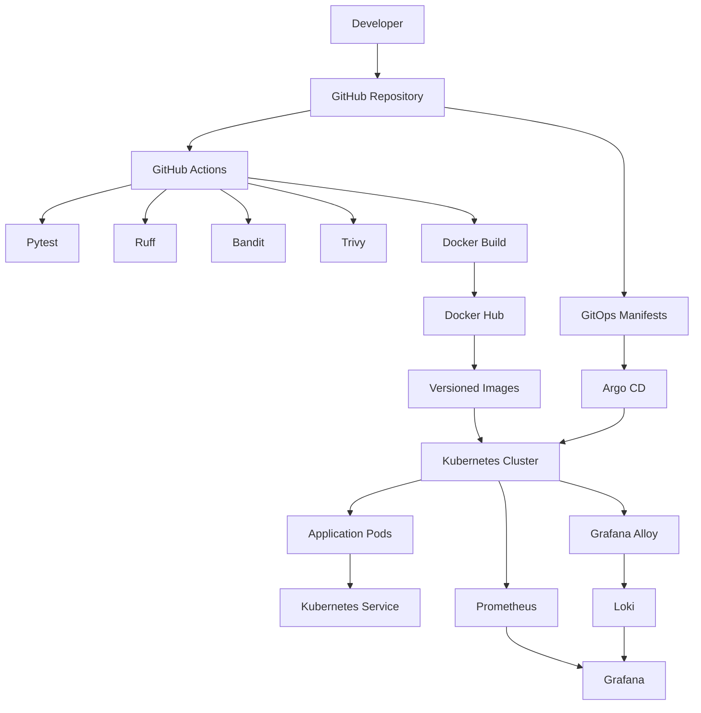
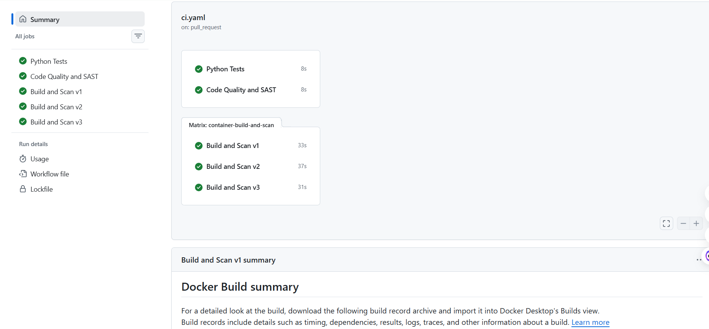
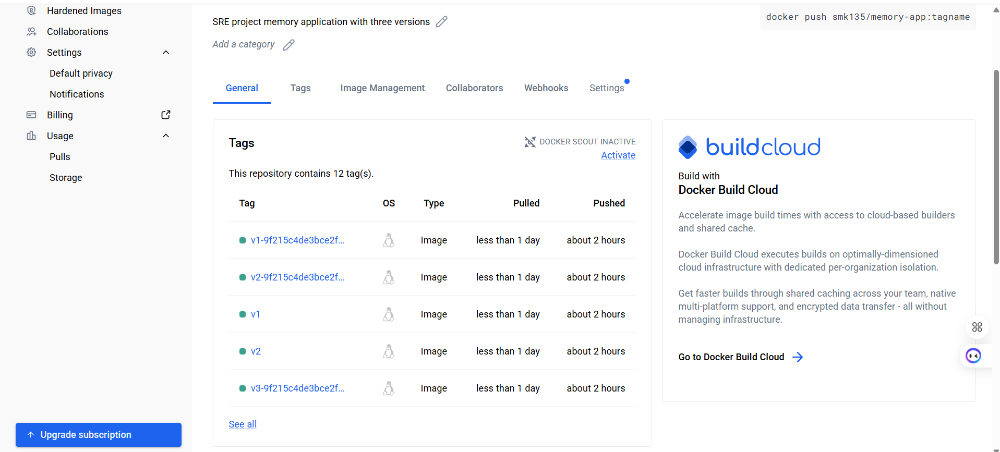
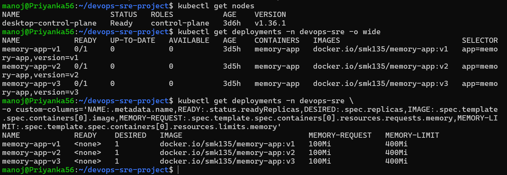
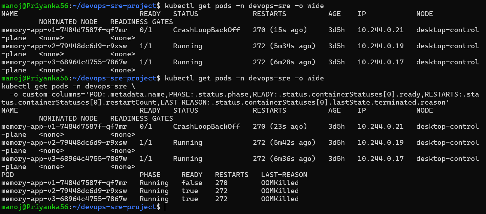
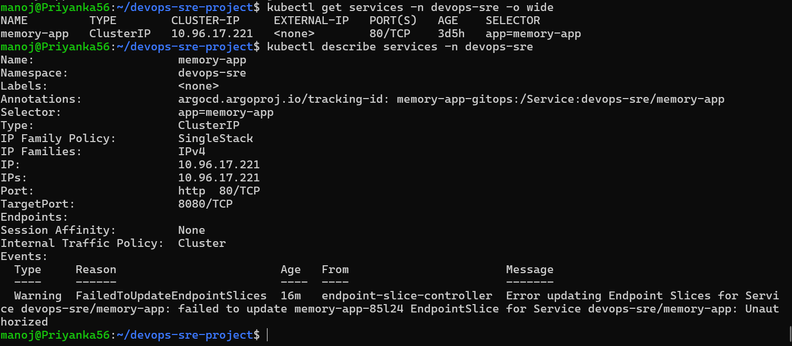
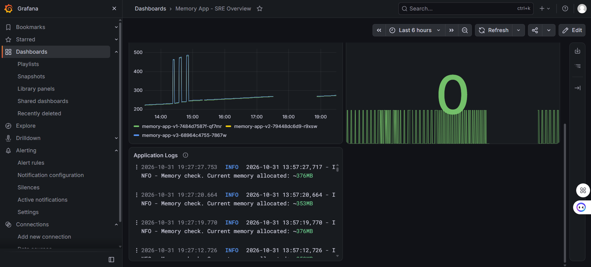
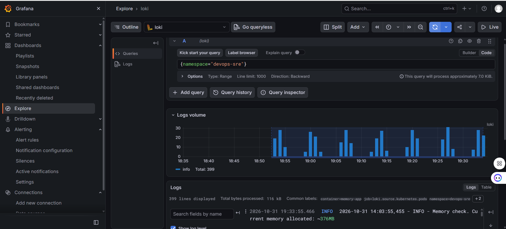
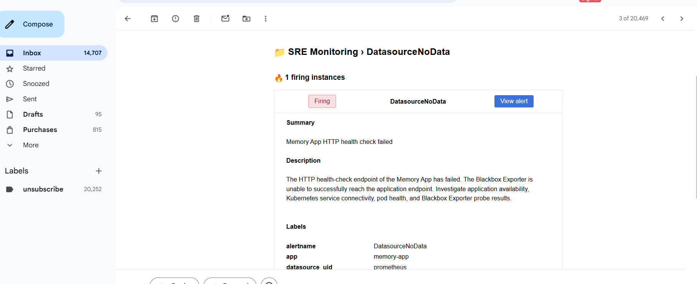
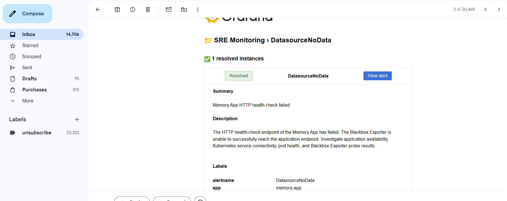

# DevOps & SRE Project
### Containerization | CI/CD | Kubernetes | GitOps | Monitoring | Centralized Logging

## 1. Introduction

I built this project to gain practical experience with the tools and workflows used by DevOps and Site Reliability Engineering teams to build, deploy, manage, and monitor applications.

Rather than focusing on individual tools in isolation, I wanted to understand how they work together in a real application delivery workflow.

For this project, I developed a Python-based application that deliberately consumes memory over time. I containerized it using Docker, implemented automated CI workflows using GitHub Actions, deployed multiple application versions on Kubernetes, and configured GitOps using Argo CD.

I also deployed an observability stack using Prometheus, Grafana, Loki, and Grafana Alloy to explore infrastructure metrics, application behaviour, and centralized logging.

One of the main objectives was to simulate a resource-exhaustion scenario, understand how Kubernetes handles container memory limits, and explore how such behaviour can be monitored.

### What I implemented

- Containerized a Python application using Docker and configured it to run as a non-root user.
- Created automated CI workflows using GitHub Actions.
- Integrated unit testing, code-quality checks, static security analysis, and container vulnerability scanning.
- Built and published versioned Docker images to Docker Hub.
- Deployed three application versions using Kubernetes Deployments.
- Managed Kubernetes deployment configurations through GitOps using Argo CD.
- Configured Kubernetes resource management and security-related resources.
- Deployed Prometheus and Grafana for monitoring.
- Configured Loki and Grafana Alloy for centralized logging.
- Simulated container memory exhaustion to understand Kubernetes OOMKilled behaviour.

---

## 2. Architecture

The project follows an application delivery and operations workflow.

I separated the application build and validation process from the Kubernetes deployment management process.

GitHub Actions handles application validation and container image workflows, while Argo CD manages the desired Kubernetes state from Git.

Prometheus, Grafana, Loki, and Grafana Alloy provide the observability components.

### Architecture Diagram



### How the architecture works

1. I maintain the application source code and Kubernetes configurations in GitHub.
2. When code changes are pushed or a pull request is created, GitHub Actions executes the configured CI checks.
3. The pipeline runs tests, linting, static security analysis, Docker builds, and container vulnerability scans.
4. Application images are published to Docker Hub with version-specific tags.
5. Kubernetes manifests define the desired deployment configuration.
6. Argo CD monitors the GitOps repository and reconciles the cluster with the desired configuration.
7. Prometheus collects metrics from the Kubernetes environment.
8. Grafana provides a centralized interface for monitoring and visualization.
9. Grafana Alloy collects Kubernetes application logs and forwards them to Loki.
10. Loki stores the collected logs so that they can be explored through Grafana.

---

## 3. Technology Stack

| Category | Technologies |
|---|---|
| Application | Python |
| Containerization | Docker |
| Version Control | Git, GitHub |
| CI/CD | GitHub Actions |
| Unit Testing | Pytest |
| Code Quality | Ruff |
| Static Security Analysis | Bandit |
| Container Scanning | Trivy |
| Container Registry | Docker Hub |
| Container Orchestration | Kubernetes |
| GitOps | Argo CD |
| Metrics Collection | Prometheus |
| Visualization | Grafana |
| Log Aggregation | Loki |
| Log Collection | Grafana Alloy |

---

## 4. Application Development

I used a Python HTTP application as the workload for this project.

The application exposes a health-check endpoint that Kubernetes can use to determine whether the application is responding.

**Health-check endpoint:**

```http
GET /healthcheck
```

**Expected response:**

```json
{
  "status": "healthy"
}
```

The application also includes a memory-allocation mechanism that progressively increases memory consumption.

I intentionally designed this behaviour to simulate an application that experiences continuous memory growth.

### Why did I choose this application?

In a production environment, applications can consume increasing amounts of memory because of inefficient processing, memory leaks, unexpected workloads, or other application-level problems.

I wanted to reproduce a controlled version of this situation rather than simply deploying an application that remains idle.

This allows me to understand:

- How container memory limits work.
- How Kubernetes handles memory exhaustion.
- Why a container gets terminated with an OOMKilled reason.
- How Kubernetes restarts terminated containers.
- How resource consumption and application failures can be investigated.

---

## 5. Dockerization

After developing the application, I containerized it using Docker.

My objective was to build a lightweight image and follow basic container security practices instead of running the application as the root user.

### Dockerfile

```dockerfile
FROM python:3.12-slim

ENV PYTHONDONTWRITEBYTECODE=1 \
    PYTHONUNBUFFERED=1

WORKDIR /app

RUN groupadd --system appgroup && \
    useradd --system --gid appgroup --no-create-home appuser

COPY --chown=appuser:appgroup app/ /app/

USER appuser:appgroup

EXPOSE 8080

CMD ["python", "-u", "app.py"]
```

### Important Dockerfile decisions

**1. Lightweight base image**

I used `python:3.12-slim` to avoid unnecessary packages and reduce the base image footprint.

**2. Non-root execution**

I created a dedicated Linux group and user named `appgroup` and `appuser`.

I then configured the container to run under that user using:

```dockerfile
USER appuser:appgroup
```

This follows the principle of least privilege and avoids running the application with unnecessary root privileges.

**3. File ownership**

I used `COPY --chown` so that the application files are owned by the application user.

**4. Unbuffered Python output**

I configured `PYTHONUNBUFFERED=1` to make application logs available immediately through container logging.

**5. Application port**

The application listens on port `8080`, which is documented using `EXPOSE 8080`.

### Building the image

```bash
docker build -t memory-app:v1 .
```

### Running the container

```bash
docker run -d \
  --name memory-app \
  -p 8080:8080 \
  memory-app:v1
```

### Testing the application

```bash
curl -i http://localhost:8080/healthcheck
```

The endpoint returns an HTTP 200 response when the application is running correctly.

---

## 6. CI Pipeline Using GitHub Actions

Once the Dockerized application was ready, I implemented automated validation using GitHub Actions.

I wanted to ensure that code changes were tested and checked before being used in the deployment workflow.

The CI workflow is maintained in:

```text
.github/workflows/ci.yaml
```

### CI stages

| Stage | Tool | Purpose |
|---|---|---|
| Unit Testing | Pytest | Verify application behaviour |
| Linting | Ruff | Identify code-quality issues |
| Static Security Analysis | Bandit | Identify potential Python security issues |
| Container Build | Docker | Build application images |
| Vulnerability Scanning | Trivy | Scan container images for known vulnerabilities |

### 6.1 Unit Testing with Pytest

I used Pytest to execute the application's automated test cases.

```bash
pytest -v
```

During local validation, the application test suite completed successfully with six passing tests.

### 6.2 Code Quality with Ruff

I integrated Ruff to identify Python linting and code-quality issues.

### 6.3 Static Security Analysis with Bandit

I integrated Bandit to perform static security analysis of the Python source code.

### 6.4 Container Scanning with Trivy

I used Trivy to scan the built Docker images for known vulnerabilities.

This adds a container security validation step to the CI workflow.

### Why I implemented these checks

Building an image successfully does not necessarily mean that the application is reliable or secure.

By combining testing, linting, static analysis, and container scanning, I can identify different categories of issues before deploying application changes.

---

## 7. Container Image Publishing

I used Docker Hub as the container image registry.

The application has three versioned image tags:

```text
docker.io/smk135/memory-app:v1
docker.io/smk135/memory-app:v2
docker.io/smk135/memory-app:v3
```

**Docker Hub repository:**

https://hub.docker.com/r/smk135/memory-app

Versioned image tags allow Kubernetes deployments to reference specific application versions.

I also configured a GitHub Actions release workflow to automate the container image publishing process.

The workflow is maintained in:

```text
.github/workflows/release.yaml
```

---

## 8. Kubernetes Deployment

After building and publishing the application images, I deployed the workloads to Kubernetes.

I created three separate Deployments to represent different application versions.

```text
memory-app-v1
memory-app-v2
memory-app-v3
```

Each Deployment maintains one application replica.

### Why three Deployments?

I wanted to understand how Kubernetes manages multiple versions of an application and how each workload can be independently configured and monitored.

The deployments use a shared Kubernetes Service to provide a stable network endpoint.

### Application resource configuration

I configured resource requests and limits for the application containers.

```yaml
resources:
  requests:
    memory: 100Mi
  limits:
    memory: 400Mi
```

**Why set a memory limit?**

A container without an appropriate memory limit can consume excessive resources and affect other workloads running on the same node.

By setting a 400Mi limit, I created a controlled boundary for the application's memory consumption.

### Health probes

I configured HTTP-based liveness and readiness probes using:

```text
/healthcheck
```

The liveness probe checks whether the application should be restarted.

The readiness probe checks whether the application is ready to receive traffic.

### Kubernetes commands used

View deployments:

```bash
kubectl get deployments -n devops-sre
```

View pods:

```bash
kubectl get pods -n devops-sre
```

View services:

```bash
kubectl get services -n devops-sre
```

Inspect a pod:

```bash
kubectl describe pod <pod-name> -n devops-sre
```

---

## 9. GitOps with Argo CD

I used Argo CD to implement GitOps-based Kubernetes deployment management.

The main idea behind GitOps is to maintain the desired application configuration in Git and use an automated controller to reconcile the Kubernetes cluster with that configuration.

Instead of relying entirely on manual `kubectl apply` commands, the deployment configuration is maintained in the Git repository.

### GitOps configuration

The Argo CD application definition is maintained in:

```text
gitops/application.yaml
```

The base Kubernetes manifests are maintained in:

```text
gitops/base/
```

### How Argo CD works in this project

1. I maintain the Kubernetes deployment manifests in Git.
2. Argo CD monitors the configured repository and application path.
3. It compares the desired configuration in Git with the live Kubernetes resources.
4. Changes are synchronized according to the configured synchronization policy.
5. Self-healing can reconcile supported manual changes made directly to managed Kubernetes resources.

### Useful commands

Check Argo CD applications:

```bash
kubectl get applications -n argocd
```

Describe the application:

```bash
kubectl describe application memory-app-gitops -n argocd
```

Check synchronization status:

```bash
kubectl get application memory-app-gitops \
  -n argocd \
  -o jsonpath='{.status.sync.status}{"\n"}'
```

---

## 10. Kubernetes Configuration and Security

I also configured Kubernetes resources to understand how application configuration, access control, and resource governance work.

### ConfigMaps

I used ConfigMaps to separate non-sensitive application configuration from the application container image.

This allows configuration to be managed independently of the application build.

### Secrets

Kubernetes Secrets are used to store sensitive configuration values.

Sensitive information such as registry credentials should not be exposed as plain text in source control.

### ServiceAccounts and RBAC

I configured ServiceAccounts, Roles, and RoleBindings to understand Kubernetes access control.

RBAC allows permissions to be assigned to identities based on the operations they need to perform.

The project includes:

- ServiceAccounts.
- Namespace-scoped Roles.
- RoleBindings.

### NetworkPolicy

I included a NetworkPolicy manifest to define network communication restrictions for selected Kubernetes workloads.

The manifest is maintained in:

```text
k8s/networkpolicy.yaml
```

### ResourceQuota

I configured a ResourceQuota to control the aggregate resource consumption of workloads in the application namespace.

This helps prevent the namespace from consuming unlimited cluster resources.

### LimitRange

I configured a LimitRange to define resource constraints and defaults for containers in the namespace.

Together, ResourceQuota and LimitRange demonstrate Kubernetes resource governance.

---

## 11. Monitoring with Prometheus and Grafana

I deployed Prometheus and Grafana to explore Kubernetes monitoring and observability.

### Prometheus

Prometheus collects and stores time-series metrics.

These metrics can be used to understand resource consumption and identify unusual behaviour in the Kubernetes environment.

### Grafana

Grafana provides dashboards and visualizations using metrics collected by Prometheus.

I use Grafana as the central interface for exploring monitoring data.

### Monitoring objectives

The monitoring setup is intended to provide visibility into:

- Node CPU utilization.
- Node memory utilization.
- Node disk utilization.
- Pod CPU consumption.
- Pod memory consumption.
- Container restart behaviour.
- Application health.

### Why monitoring is important

Monitoring helps identify resource constraints and application behaviour that may not be visible from application logs alone.

For example, when an application continuously consumes memory, observing its memory usage and restart behaviour provides useful information for troubleshooting.

---

## 12. Centralized Logging with Loki and Grafana Alloy

I configured Loki and Grafana Alloy as part of the centralized logging stack.

### Why centralized logging?

In Kubernetes, applications run inside containers, and pods can be terminated and recreated.

Inspecting logs from individual containers becomes inconvenient when managing multiple workloads.

Centralized logging provides a common place to collect and explore application logs.

### Grafana Alloy

Grafana Alloy is responsible for collecting Kubernetes pod logs and forwarding them to Loki.

### Loki

Loki receives and stores the logs.

I can then use Grafana to explore the collected log data.

### Logging workflow

```text
Application Pods
       |
       v
Grafana Alloy
       |
       v
      Loki
       |
       v
    Grafana
```

The logging configuration is maintained under:

```text
monitoring/
```

---

## 13. Simulating Memory Exhaustion and OOMKilled Behaviour

One of the most important parts of this project is the intentional memory-exhaustion scenario.

I designed the application to allocate memory progressively until it reaches the configured container memory limit.

The application container has a memory limit of 400Mi.

When the container exceeds that limit, it can be terminated by the Linux kernel's OOM mechanism.

Kubernetes reports this termination with:

```text
Reason: OOMKilled
Exit Code: 137
```

### Expected application behaviour

```text
Application Starts
       |
       v
Memory Allocation Begins
       |
       v
Memory Consumption Increases
       |
       v
Container Reaches Memory Limit
       |
       v
Container Gets OOMKilled
       |
       v
Kubernetes Restarts Container
```

### What I wanted to understand

Through this scenario, I explored:

- How Kubernetes enforces container memory limits.
- What happens when a container exceeds its memory allocation.
- How Kubernetes reports OOMKilled events.
- How container restart policies work.
- How to inspect previous container logs.
- How resource consumption can be investigated.

### Commands used for troubleshooting

Check pod status:

```bash
kubectl get pods -n devops-sre
```

Inspect container termination information:

```bash
kubectl get pods -n devops-sre \
  -o jsonpath='{range .items[*]}{.metadata.name}{" | "}{.status.containerStatuses[0].lastState.terminated.reason}{" | Exit: "}{.status.containerStatuses[0].lastState.terminated.exitCode}{"\n"}{end}'
```

Inspect previous container logs:

```bash
kubectl logs <pod-name> -n devops-sre --previous
```

Describe the pod:

```bash
kubectl describe pod <pod-name> -n devops-sre
```

**Important:** The OOMKilled behaviour is intentional for this application. The objective is to simulate and investigate resource exhaustion, not to remove the behaviour by increasing the memory limit.

---

## 14. Repository Structure

```text
devops-sre-project/
│
├── app/
│   └── app.py
│
├── test/
│   └── test_case.py
│
├── .github/
│   └── workflows/
│       ├── ci.yaml
│       └── release.yaml
│
├── gitops/
│   ├── application.yaml
│   └── base/
│       ├── configmap.yaml
│       ├── deployment.yaml
│       ├── limitrange.yaml
│       ├── rbac.yaml
│       ├── resourcequota.yaml
│       ├── service.yaml
│       └── serviceaccount.yaml
│
├── k8s/
│   ├── configmap.yaml
│   ├── limitrange.yaml
│   ├── networkpolicy.yaml
│   ├── rbac.yaml
│   ├── resourcequota.yaml
│   ├── service.yaml
│   └── serviceaccount.yaml
│
├── monitoring/
│   ├── alloy-values.yaml
│   └── loki-values.yaml
│
├── monitoring-values.yaml
├── Dockerfile
├── requirements-dev.txt
└── README.md
```

---

## 15. Running the Project Locally

### Prerequisites

- Git
- Python 3.12+
- Docker
- kubectl
- Helm
- Kubernetes cluster

### Step 1: Clone the repository

```bash
git clone https://github.com/manojsambana443/devops-sre-project.git

cd devops-sre-project
```

### Step 2: Create a virtual environment

```bash
python3 -m venv .venv
```

Activate it on Linux or WSL:

```bash
source .venv/bin/activate
```

Activate it on Windows:

```powershell
.venv\Scripts\activate
```

### Step 3: Install development dependencies

```bash
pip install -r requirements-dev.txt
```

### Step 4: Execute unit tests

```bash
pytest -v
```

### Step 5: Build the Docker image

```bash
docker build -t memory-app:v1 .
```

### Step 6: Start the application

```bash
docker run -d \
  --name memory-app \
  -p 8080:8080 \
  memory-app:v1
```

### Step 7: Verify the health endpoint

```bash
curl http://localhost:8080/healthcheck
```

---

## 16. Useful Kubernetes Commands

| Operation | Command |
|---|---|
| View cluster nodes | `kubectl get nodes` |
| View application pods | `kubectl get pods -n devops-sre` |
| View deployments | `kubectl get deployments -n devops-sre` |
| View services | `kubectl get svc -n devops-sre` |
| Inspect a pod | `kubectl describe pod <pod-name> -n devops-sre` |
| View application logs | `kubectl logs <pod-name> -n devops-sre` |
| View previous logs | `kubectl logs <pod-name> -n devops-sre --previous` |
| View namespace events | `kubectl get events -n devops-sre --sort-by=.lastTimestamp` |
| Check resource quota | `kubectl describe resourcequota devops-sre-quota -n devops-sre` |
| View monitoring pods | `kubectl get pods -n monitoring` |
| View Argo CD applications | `kubectl get applications -n argocd` |

---

## 17. Challenges and Technical Learnings

While implementing this project, I worked through several practical issues that helped me understand the behaviour of the underlying technologies.

### Docker credential configuration

I encountered a Docker credential-helper issue while building the application image in my WSL environment.

The Docker configuration referenced a Windows Docker Desktop credential helper that was not available in the Linux environment.

Investigating the Docker configuration helped me understand how Docker manages registry credentials and how environment-specific configuration can affect container builds.

### Container memory exhaustion

I observed the application progressively consuming memory until the container reached its configured memory limit.

Docker and Kubernetes reported the resulting termination as OOMKilled.

This helped me understand the relationship between container memory limits, Linux process termination, and Kubernetes restart behaviour.

### Kubernetes resource management

I also investigated how namespace ResourceQuota affects pod scheduling and deployment updates.

This demonstrated that individual container resource limits and aggregate namespace quotas are different controls, and both need to be considered when managing workloads.

### GitOps reconciliation

Working with Argo CD helped me understand how Git acts as the source of truth for Kubernetes configurations and how the controller reconciles desired and live resource states.

---

## 18. Conclusion

Building this project helped me connect several important DevOps and SRE concepts into one practical workflow.

Instead of learning Docker, Kubernetes, CI/CD, GitOps, monitoring, and logging independently, I implemented them as components of the same application delivery and operations environment.

The intentional memory-exhaustion scenario was particularly useful because it provided an opportunity to observe how container resource limits work and how Kubernetes responds when an application exceeds those limits.

Overall, this project strengthened my practical understanding of containerization, automated validation, Kubernetes workload management, GitOps, and observability.

---

## Project Links

- **GitHub Repository:** https://github.com/manojsambana443/devops-sre-project
- **Docker Hub:** https://hub.docker.com/r/smk135/memory-app


---

# Project Implementation Evidence

The following screenshots demonstrate the implementation and working state of the project's CI/CD pipeline, container registry, Kubernetes deployments, GitOps workflow, monitoring, centralized logging, and alerting.

## 1. CI/CD Pipeline and Container Registry

### GitHub Actions – Code Quality and Security Scanning



### Docker Hub – Published Container Images



## 2. Kubernetes Deployment and Resource Management

### Kubernetes Deployments



### Kubernetes Pods



### Kubernetes Services


### Resource Requests and Limits


### OOMKilled Demonstration


## 3. GitOps with Argo CD

### Argo CD Application Overview


## 4. Monitoring and Observability

### Prometheus Targets


### Grafana Monitoring Dashboard



### Additional Grafana Dashboard



## 5. Centralized Logging and Alerting

### Centralized Logging with Loki



### Grafana Alert – Firing



### Grafana Alert – Resolved


